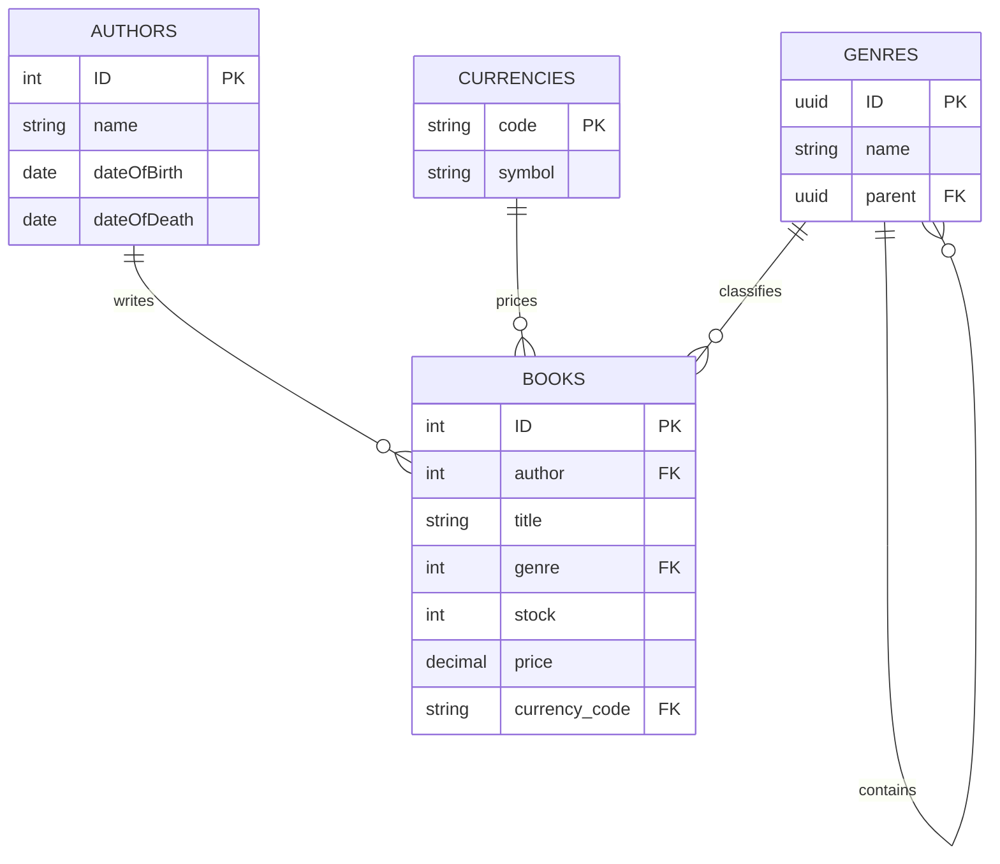

# Database layer

The database model is defined in `db/schema.cds` in the `sap.capire.bookshop` namespace. SAP Cloud Application Programming Model (CAP) compiles this CDS model to the configured persistence service (SQLite for local development).

## Entities

- **Books**: the catalog's books. Each book has a title, optional description, stock and price, and is associated with one `Author` and optionally one `Genre`.
- **Authors**: author master data, including dates and places of birth and death. The `books` association provides the reverse navigation to books.
- **Genres**: a hierarchical code list implemented with a self-association (`parent`) and composition (`children`).
- **Currencies**: supplied by `@sap/cds/common`; `db/init.js` ensures a small local set (EUR, USD, GBP, ILS and JPY) exists.

`Books` and `Authors` use integer keys because this sample intentionally keeps the model close to the CAP getting-started example. `Genres` uses the reusable `cuid` aspect. `managed` adds audit fields such as `createdAt` and `modifiedAt` to books and authors.



## Validation and initialization

`db/init.js` upserts the local currencies after the CDS server has been served, so the values are available alongside CSV seed data without requiring the optional common-data package.

Additional write constraints are defined in `srv/admin-constraints.cds`:

- book titles, author references and genre references are mandatory/validated;
- prices must be between 1 and 111;
- stock cannot be negative;
- author dates must be chronological;
- a genre cannot be its own parent.

The `@fiori.draft.enabled` annotation on `Books` supports draft-aware consumers and requires the generated text data to include the expected localized text columns when draft data is loaded.

## Local persistence

Install dependencies and start the service from the repository root:

```sh
npm install
npm run watch
```

By default CAP uses the SQLite development setup supplied by `@cap-js/sqlite`. The CDS model remains persistence-independent and can be deployed to another CAP-supported database using the appropriate adapter and deployment process.
