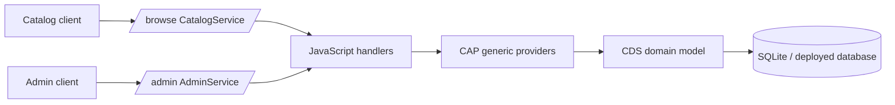

# Service layer

The service layer exposes the database model through two CAP application services. CDS definitions live in `srv/`; JavaScript handlers contain only behavior that cannot be expressed by the generic CAP providers.

## CatalogService

Catalog consumers use the `/browse` service path.

| Entity/action | Purpose |
| --- | --- |
| `ListOfBooks` | Read-only list projection. It omits the long description and exposes author/genre display data suitable for a list page. |
| `Books` | Read-only detail projection. It denormalizes `author.name` and `genre.name` for a detail view. |
| `submitOrder` | Decreases stock for a book when enough stock is available. Requires an authenticated user. |

The service is available through OData, REST and HCQL. MCP and A2A annotations are included as optional integrations; install `@cap-js/mcp` or `@cap-js/agents` before enabling those runtimes.

### Ordering behavior

`submitOrder` accepts a book ID and quantity (default `1`, maximum `111`). The handler performs a conditional update so stock is reduced only when the requested quantity is available:

1. If the update affects a row, the request succeeds.
2. If the book does not exist, the service returns `404`.
3. If the book exists but has insufficient stock, it returns `409` with the requested quantity and current stock.

The list projection adds an `11% discount` marker to titles whose stock is greater than `111`; this is presentation metadata only and does not change the stored price.

Example OData requests after starting the application:

```sh
curl http://localhost:4004/browse/ListOfBooks
curl http://localhost:4004/browse/Books(1)
curl -X POST http://localhost:4004/browse/submitOrder \
  -H 'Content-Type: application/json' \
  -d '{"book": 1, "quantity": 1}'
```

## AdminService

Administrators use `/admin`. It exposes CRUD projections for `Authors`, `Books` and `Genres`. HCQL and REST are enabled, and MCP support is annotated as optional.

The JavaScript handler generates an integer ID for new authors and books when the caller does not provide one. This is deliberately a sample-only implementation and is not safe for concurrent production writes; use database-generated keys or a transactional sequence in a production application.

The admin service is currently open for the getting-started sample. The commented `@requires: 'admin'` annotation in `srv/admin-constraints.cds` shows where role protection can be enabled.

## Service composition


